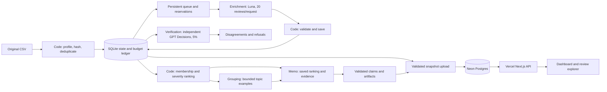

# Spotify Review Evidence — 100,000-review submission

[Live dashboard](https://spotify-review-evidence-100k.vercel.app) · [Reviewed recommendation](artifacts/runs/production-100k-v1/revisions/submission-review-v1/memo.md) · [Measured cost and time](cost/production_100k/report.md)

The **100,000-review run is complete**, with original source IDs and hashes, four separately prompted roles, saved attempts/usage, recovery recordings, human evaluation, and a Vercel frontend/API backed by Neon Postgres. Browsing the app reads saved results and makes no model calls.

**Scope:** all **660,622 rows were ingested and profiled**. Classification covers a seeded sample of **100,000 original nonempty IDs**, the assignment's at-least-100k option. It does **not** classify the entire corpus. There are 13 empty source texts; the other 560,609 nonempty IDs are explicitly outside this analysis. The stricter supplied full-file checker consequently reports incomplete full classification. This limitation is preserved.

## Actual results

| Measurement | Saved result |
|---|---:|
| Completed original review IDs | **100,000 / 100,000** |
| Distinct texts / exact-text reuses | 78,288 / 21,712 |
| Independent source-ID sample | 5,000 (5%) |
| Complete independent predictions / remaining partial answers | **5,000 / 0** after the authorized final repair |
| Active pipeline time, including retries | **55.69 minutes** |
| First paid dispatch to last response, including recovery gaps | **76.94 minutes** |
| Warm replay | 15.61 seconds, **zero new model calls** |
| This run's usage-based API estimate | **US$4.083881615** |
| This run's unresolved reserves | US$0.174263125 across 48 failed requests |
| All pilots + production + all unresolved reserves | **US$4.977749605 / US$10** |
| Offline control tests | 42 passed; simulated providers, separate from business records |

Times describe the original 100k execution and exclude later quality checks, website development/deployment and upload. The supplemental final checks made four calls costing US$0.002482925, within their separately authorized US$0.05 cap. API estimates use recorded usage and editable dated rates; they are not a reconciled invoice. Missing usage is visible, never treated as free. Hosting, hardware and electricity are separate and unmeasured. [Run summary](cost/production_100k/run_summary.json) · [Attempts](cost/production_100k/calls.jsonl) · [Global ledger](cost/budget_ledger.json).

**Investigate usability first:** 12,575 complaint/cancellation reviews, severity sum 32,625, mean severity 2.594433. Playback is second by score (23,392), with higher mean severity (3.269779). Other is third (22,188), but is a broad catch-all requiring investigation before it becomes a concrete product task. Billing is fourth (17,132). These historical, self-selected reviews do not establish current defect rates, causation or measured churn. [Ranking](artifacts/runs/production-100k-v1/ranking.csv) · [Memo inspection](evals/production_100k/memo_review.md).

## Four roles and code boundaries



| Role | Language judgment | Code-owned boundary |
|---|---|---|
| Enrichment | Topic, intent, severity, sentiment, review flag | Original text/ID only; strict schema/IDs/ranges; atomic save |
| Verification | Independent labels from text and rubric | Seeded original-ID sample; no enrichment predictions or human answers |
| Grouping | Issue names and descriptions | At most 3 examples/topic; fixed membership and stable IDs |
| Memo | Argument and alternatives | Saved ranking/evidence only; checked references and claim-backed numbers |

The inexpensive model is `gpt-6-luna`, Standard/default tier, reasoning `none`, maximum 4,096 response tokens. Responses handles enrichment, grouping and memo; GPT Decisions provides independent verification in ten-review batches. This combines Decisions with Luna; stronger-model fallback stays at 0%. Requested/returned model IDs and settings are logged. No hidden SDK retries: at most three attempts/task, one invalid-output retry and two transient retries. Review instructions are untrusted.

Sixteen enrichment workers overlap requests; verification uses up to eight. A persistent SQLite queue gives each task one claim. Transactions reserve maximum cost before dispatch; spent plus unresolved reservations shares a US$10 ceiling across all experiments. The active deadline is three hours. Cache keys include all label-affecting settings and batch-context identity. Exact-text aliases point directly to validated originals under the same settings; every source ID counts in aggregates. Earlier batch-ten outputs were not silently mixed into production.

`evidence_quote` is code-grounded to the entire original review; `entities` use a declared literal feature lexicon. Models supply the language judgments. Literal validity does not establish semantic support; deterministic quote/entity agreement is not independent accuracy evidence. Ratings and metadata remain for provenance, never as classification inputs.

Code assigns each complaint/cancellation to exactly one topic issue. Priority is `severity_sum`; descending score then ascending issue ID gives stable ordering. Means use six-decimal half-up rounding. Praise, requests and unclear records do not enter the complaint ranking. [Prompts and rubric](spotify_pipeline/prompts/) · [Production architecture](docs/production.md).

## Quality and checker status

The original seeded 5,000-ID sample now has **5,000 complete independent predictions and zero remaining partial answers**. The user authorized one final attempt for each of the original two refused IDs, with an absolute three-attempt maximum. Both completed in one two-review request. All original refusals, failed attempts and baseline reports remain preserved. No source ID was substituted and no business classification was changed. Final agreement: topic **88.30%**, intent **93.00%**, severity **79.42%**, severity MAE **0.2176**, sentiment MAE **0.116349**. This is **same-model-family consistency, not human accuracy**. [Reviewed verification and provenance](artifacts/runs/production-100k-v1/revisions/submission-review-v1/) · [Original baseline quality](evals/production_100k/verification_quality.json).

The **final batch-twenty configuration** was evaluated separately against all 50 original human labels: topic **74%**, intent **86%**, severity **72%**, severity MAE **0.32**, sentiment MAE **0.198**. All 50 predictions are valid, using three new requests and one exact-text alias. [Final results and concrete failures](evals/production_golden/results.md) · [Complete comparison](evals/production_golden/golden_report.json) · [Acceptance and settings](evals/production_golden/acceptance.json).

The earlier batch-ten human comparison remains topic 82%, intent 88%, severity 66%, severity MAE 0.40 and sentiment MAE 0.238. Final topic/intent agreement is lower while severity agreement is higher; this is a descriptive comparison, not proof of a population-wide change. The original labels, original predictions and all 21 later adjudications remain separate. No post-AI adjudicated answers were substituted in the final evaluation. Human category coverage remains limited: access, billing and downloads have no reference cases. These small evaluations do not establish general production accuracy.

The scoped checker validates 100,000 IDs, hashes, quotes, cache provenance, membership, claims and ranking. Status remains **`review_required`** because 48 failed requests lack input/output usage (96 fields). The full-file adapter additionally reports 560,609 unclassified nonempty reviews. Neither is presented as a clean checker pass or a full-corpus run. [Acceptance](evals/production_100k/acceptance.json) separates successful processing controls from a fully reconciled checker pass, which remains false.

## Reproduce without an API key

Python 3.11+; verified with 3.14.7. No third-party runtime dependencies; build dependency pinned. The full 97.4 MB supplied CSV and large operational SQLite state are excluded from Git. The original 100k subset, processed records, and full-file accounting export are included.

```sh
python3 -m venv .venv
.venv/bin/python -m pip install --no-deps -e .
python3 -m unittest discover -s tests
python3 -m spotify_pipeline production-replay
python3 -m spotify_pipeline rank --run-id production-100k-v1
python3 -m spotify_pipeline cost replay
python3 scripts/verify_deployment.py --reviewed
```

Ranking falls back to saved artifacts when SQLite is absent. Rate edits recompute API costs; changing projected volume preserves measured results. The acceptance audit verifies doubled rates double API spend without changing measured time. Full-corpus projections are estimates, not further authorized execution. Raw production handoffs are archived as `handoffs.tar.gz` in the public package; unpack inside the run directory for inspection.

Restore the unchanged original full CSV to repeat full ingestion and auditing offline:

```sh
python3 -m spotify_pipeline prepare --input spotify_reviews_18months.csv
python3 scripts/audit_production.py
python3 -m spotify_pipeline check --run-id production-100k-v1
```

Paid commands require `--execute-paid` and a locally configured `OPENAI_API_KEY`. Do not rerun paid work to grade this submission. Original interfaces remain: `pilot`, `checkpoint`, `scaling-pilot`, `production`, `label-golden`, `evaluate`. Historical measurements and failures are preserved. [Development history](docs/history/development_checkpoints.md).

## Rubric evidence map

| Requirement | Evidence |
|---|---|
| Full-file profile and checksums | [Ingestion](artifacts/ingestion/), [supplied manifest](manifest.json), [dataset README](README.dataset.md) |
| 100k original IDs, labels and hashes | [Source CSV](artifacts/runs/production-100k-v1/input_100000.csv), [records](artifacts/runs/production-100k-v1/records.jsonl), [manifest](artifacts/runs/production-100k-v1/run_manifest.json) |
| Four roles and handoffs | [Prompts](spotify_pipeline/prompts/), production `handoffs.tar.gz`, [architecture](docs/production.md) |
| Original 100-review cold/warm experiment | [Report](cost/report.md), [records](cost/pilot_records.jsonl), [attempts](cost/pilot_calls.jsonl), [rates](cost/rates.csv) |
| Real interruption and resume | [100-review recording](artifacts/runs/pilot-100-v2/recovery.cast), [before](artifacts/runs/pilot-100-v2/grading/checkpoint_before.json), [after](artifacts/runs/pilot-100-v2/grading/checkpoint_after.json), [100k recordings](artifacts/runs/production-100k-v1/terminal/) |
| Batching, cache, parallel queues and budget | [Production](spotify_pipeline/production.py), [queue](spotify_pipeline/scaling.py), [summary](cost/production_100k/run_summary.json), [ledger](cost/budget_ledger.json) |
| Offline cost/time calculator | [100k report, rates and arithmetic](cost/production_100k/), [invariant checks](evals/production_100k/acceptance.json) |
| Fifty human labels and disagreements | [Original labels](evals/golden_labels.json), [final-configuration results](evals/production_golden/results.md), [earlier results](evals/golden_results.md), [reviewed choices](evals/golden_adjudication_results.md) |
| Independent verification | [Final quality](artifacts/runs/production-100k-v1/revisions/submission-review-v1/verification_quality_reviewed.json), [final comparisons](artifacts/runs/production-100k-v1/revisions/submission-review-v1/verification_reviewed.json), [original comparisons](artifacts/runs/production-100k-v1/verification.json), [error analysis](evals/production_100k/error_analysis.md) |
| Injection, planted errors and recovery tests | [Diagnostics](cost/diagnostics.json), [test outcomes](evals/system_checks.json), [tests](tests/) |
| Deterministic ranking and recommendation | [Membership](artifacts/runs/production-100k-v1/membership.csv), [ranking](artifacts/runs/production-100k-v1/ranking.csv), [claims](artifacts/runs/production-100k-v1/claims.csv), [reviewed memo](artifacts/runs/production-100k-v1/revisions/submission-review-v1/memo.md), [original memo](artifacts/runs/production-100k-v1/memo.md), [inspection](evals/production_100k/memo_review.md) |
| Checker and honest scope accounting | [Scoped checker](artifacts/runs/production-100k-v1/self-check.json), [full checker](evals/production_100k/full_file_self_check.json), public `grading/` export |
| Deployed frontend/API/database | [Vercel dashboard](https://spotify-review-evidence-100k.vercel.app), [source](dashboard-vercel/), [Neon schema](dashboard-vercel/db/001_schema.sql), [signed-out checks](evals/dashboard/vercel_live_e2e.json) |

The repository is the submission entry point. No course-portal submission has been made on the student's behalf. The private Sites prototype is superseded by Vercel. No further paid calls are needed for this 100k milestone.

Dataset: supplied extract from [BwandoWando version 2](https://www.kaggle.com/datasets/bwandowando/3-4-million-spotify-google-store-reviews), publisher-listed CC0. Full-source SHA-256: `1fc85de68a304dd8978b537cfa58793d5f41cbaf417fa32cb53899f83a2fcef6`.

## Published submission corrections

The reviewed memo explicitly identifies the resolved crash report as historical. The deployed dashboard displays complete verification counts, the reserved cost for 48 requests with unavailable usage, and the final-configuration human comparison. Original 100k records, ranking and claims are byte-for-byte unchanged. Original generated memo, measurement files and partial-refusal evidence remain available as the baseline.

The approved additional checks cost **US$0.002482925 / US$0.05**. All recorded API work plus unresolved reserves totals **US$4.977749605 / US$10**. [Final definition-of-done checklist](evals/production_100k/definition_of_done.md) · [Correction acceptance](evals/production_100k/corrections_acceptance.json) · [Usage reconciliation inventory](evals/production_100k/usage_reconciliation.json). Missing historical request usage remains unavailable; aggregate billing is not substituted for exact per-request token counts. This is the remaining checker exception.
