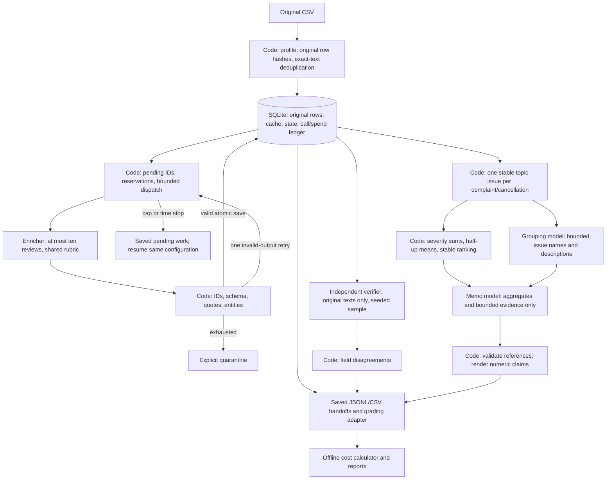

> Historical 100/500-review architecture notes. The completed 100k implementation and deployed Vercel/Neon architecture are documented in [production.md](production.md).

# Architecture and role boundaries

The four roles have separate instructions, schemas, call logs and saved handoffs
even though the same inexpensive model serves all roles. Code determines stage
order, sample selection, issue membership, arithmetic, limits, retries and state.
Models interpret language, independently relabel, name issues and propose an
argument. No role has tools, arbitrary autonomy or access to API credentials.

The final pilot uses extraction policy v2. Code supplies the entire original
review as `evidence_quote` and matches a small declared feature-term lexicon for
`entities` (preserving exact source spelling). Models return empty placeholders
for these fields and judge topic, intent, sentiment, severity and needs_review.
Raw placeholders remain visible in call handoffs; final records contain the
code-grounded values. Whole-text quotes guarantee substring membership, not label
correctness. Human inspection must still check whether the review supports the
language judgments. Quote/entity agreement in verification is deterministic and
is not evidence of independent semantic accuracy.

An earlier development experiment used model extraction and rejected entire
batches for entity capitalization mismatches. It remains under the original run
ID and `cost/experiments/pilot-100-v1/`. The final configuration uses a separate
fresh-cache run, `pilot-100-v2`, because its prompt and extraction policy changed.
All experiments share the same US$2 ledger; the failed experiment is excluded
from final measured-100 projections but its usage and failures remain disclosed.

Enrichment tasks contain only review IDs and text. Original source metadata is
retained for provenance/analysis and never substituted for textual interpretation.
The exact original six-string row hash comes from the instructor's helper.
Exact duplicates retain all source IDs and point directly to their original
completed classification. Different model, effort, schema, tier, output cap or
enrichment prompt invalidates reuse. Caches are isolated per experiment.

Each stage saves inputs/outputs under the run directory and call handoffs. A
successful validated model response is committed before record application, so
a restart can apply it without a new charge if interrupted between those steps.
Timeouts retain worst-case reservations; the local ledger is conservative, not
a substitute for reconciling the provider's actual bill.

Stage stop rules: enrichment ends after all input IDs have a status; verification
ends after the declared sample; grouping ends after naming existing issues; memo
ends after a validated structured response. Provider/account errors stop the run.
Invalid output retries once; transient failures have at most three total attempts.

The pilot uses broad primary-topic issues deliberately. It does not claim to have
discovered fine-grained product defects. Accepting richer subtopics later requires
a versioned, saved membership mapping and new deterministic ranking.

The required production architecture is a later milestone: processed database
→ deployed backend → dashboard showing metrics, rankings, saved recommendations
and review/claim evidence. No dashboard, backend hosting or production database
deployment is claimed by this pilot.

## 500-review extension

The explicit `checkpoint` command accepts only the checksum-verified supplied
500-row file and never dispatches larger inputs. It inherits the successful
100-review outputs only after checking identical classification settings and
exact source row values/hashes. Historical model calls remain verbatim provenance
in a separate artifact and the grading adapter; they are not new ledger entries.
New work shares the existing one-worker lock and US$2 spending ledger.

The 500-row input has 479 distinct texts. After inheriting 100 original results,
379 new model classifications plus exact-text reuse account for all 500 IDs.
Verification samples original source rows, not the deduplicated text frame.
The checkpoint records an additional interruption/restart, regenerates bounded
issue names and memo inputs, and measures its incremental time and warm replay.
Its calculator refreshes estimates from the new language work with explicit
denominators rather than pretending reused records were newly processed.
